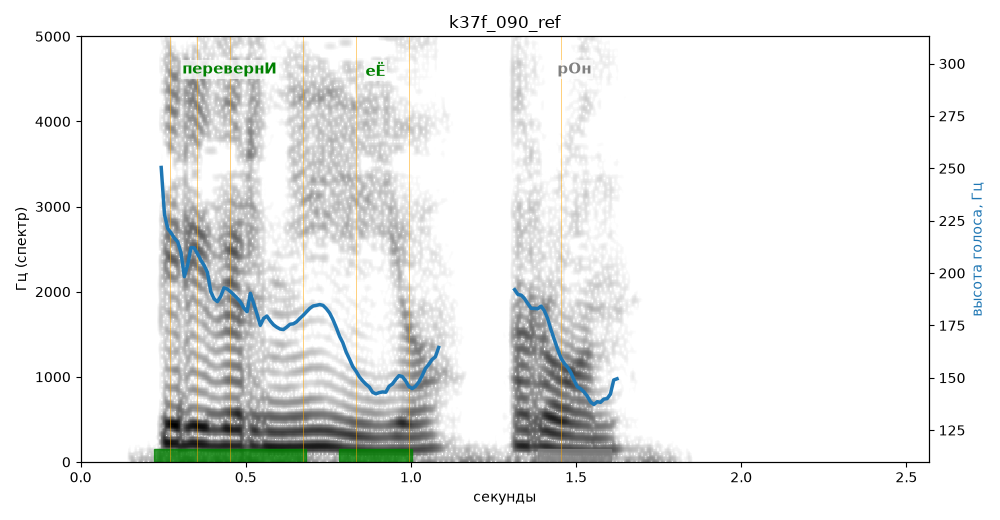

# k37f_090_ref

Голос: **edge:ru-RU-SvetlanaNeural** · длительность 2.6 с
Эталон: Переверни её, Рон!
Распознано: Переверни ее, Рон.
Слова: все совпали

## Ударения
(где нужно: ruaccent)

| слово | нужно | у голоса | |
|---|---|---|---|
| переверни | перевернИ | перевернИ | ✓ |
| её | еЁ | еЁ | ✓ |

## Интонация
- ✗ «переверни её рон!» — восклицание звучит ровно, без эмоции
- Диапазон голоса 7.1 полутонов (живо), средняя высота 175 Гц

## Паузы и темп
- паузы на своих местах
- Темп 7.0 слога/с (быстро)

_Синяя линия — высота голоса. Над словами заглавная буква — где ударение должно быть; красным — голос поставил не туда (уверенно), оранжевым — возможно._
