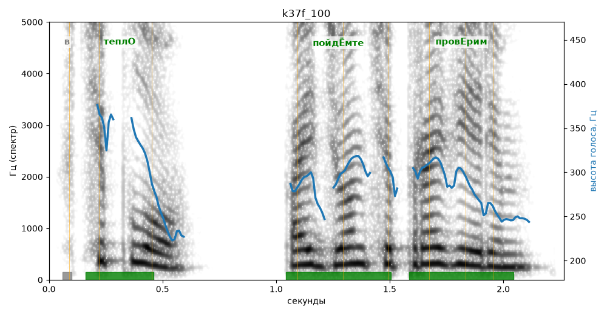

# k37f_100

Голос: **Филя, сборка 37f** · длительность 2.3 с
Эталон: В тепло? Пойдёмте проверим!
Распознано: В тепло пойдемте проверим.
Слова: все совпали

## Ударения
(где нужно: ruaccent)

| слово | нужно | у голоса | |
|---|---|---|---|
| тепло | теплО | теплО | ✓ |
| пойдёмте | пойдЁмте | пойдЁмте | ✓ |
| проверим | провЕрим | провЕрим | ✓ |

## Интонация
- ✗ «пойдёмте проверим!» — восклицание звучит ровно, без эмоции
- Диапазон голоса 7.3 полутонов (живо), средняя высота 292 Гц

## Паузы и темп
- паузы на своих местах
- Темп 6.4 слога/с (нормально)

_Синяя линия — высота голоса. Над словами заглавная буква — где ударение должно быть; красным — голос поставил не туда (уверенно), оранжевым — возможно._
