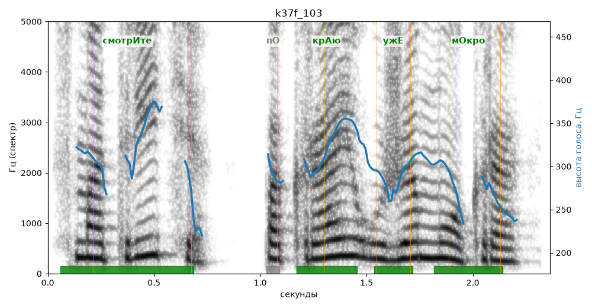

# k37f_103

Голос: **Филя, сборка 37f** · длительность 2.4 с
Эталон: Смотрите, по краю уже мокро!
Распознано: Смотрите, по краю уже мокра.
Расхождения в словах: «мокро» → «мокра»

## Ударения
(где нужно: ruaccent)

| слово | нужно | у голоса | |
|---|---|---|---|
| смотрите | смотрИте | смотрИте | ✓ |
| краю | крАю | крАю | ✓ |
| уже | ужЕ | ужЕ | ✓ |
| мокро | мОкро | мОкро | ✓ |

## Интонация
- ✓ «смотрите по краю уже мокро!» — выделено слово «смотрите» (+2.5 пт)
- Диапазон голоса 7.0 полутонов (живо), средняя высота 302 Гц

## Паузы и темп
- паузы на своих местах
- Темп 5.2 слога/с (нормально)

_Синяя линия — высота голоса. Над словами заглавная буква — где ударение должно быть; красным — голос поставил не туда (уверенно), оранжевым — возможно._
