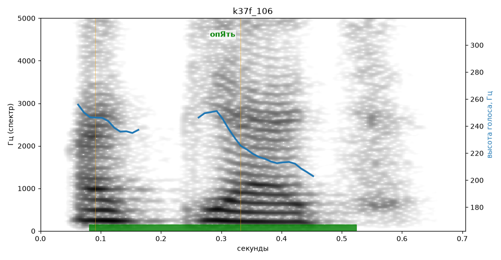

# k37f_106

Голос: **Филя, сборка 37f** · длительность 0.7 с
Эталон: Опять.
Распознано: Опять!
Слова: все совпали

## Ударения
(где нужно: ruaccent)

| слово | нужно | у голоса | |
|---|---|---|---|
| опять | опЯть | опЯть | ✓ |

## Интонация
- Диапазон голоса 3.3 полутонов (монотонно, как робот), средняя высота 236 Гц

## Паузы и темп
- паузы на своих местах
- Темп 4.5 слога/с (нормально)

_Синяя линия — высота голоса. Над словами заглавная буква — где ударение должно быть; красным — голос поставил не туда (уверенно), оранжевым — возможно._
