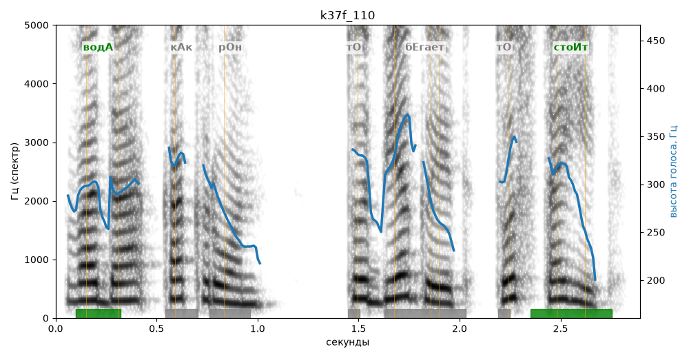

# k37f_110

Голос: **Филя, сборка 37f** · длительность 2.9 с
Эталон: Вода — как Рон. То бегает, то стоит.
Распознано: Вода как рон. То бегает, то стоит.
Слова: все совпали

## Ударения
(где нужно: ruaccent)

| слово | нужно | у голоса | |
|---|---|---|---|
| вода | водА | водА | ✓ |
| бегает | бЕгает | бегаЕт | ? не разобрать |
| стоит | стоИт | стоИт | ✓ |

## Интонация
- ✓ «вода как рон.» — конец фразы понижается — звучит законченно
- ✓ «то бегает то стоит.» — конец фразы понижается — звучит законченно
- Диапазон голоса 6.7 полутонов (нормально), средняя высота 298 Гц

## Паузы и темп
- паузы на своих местах
- Темп 6.2 слога/с (нормально)

_Синяя линия — высота голоса. Над словами заглавная буква — где ударение должно быть; красным — голос поставил не туда (уверенно), оранжевым — возможно._
