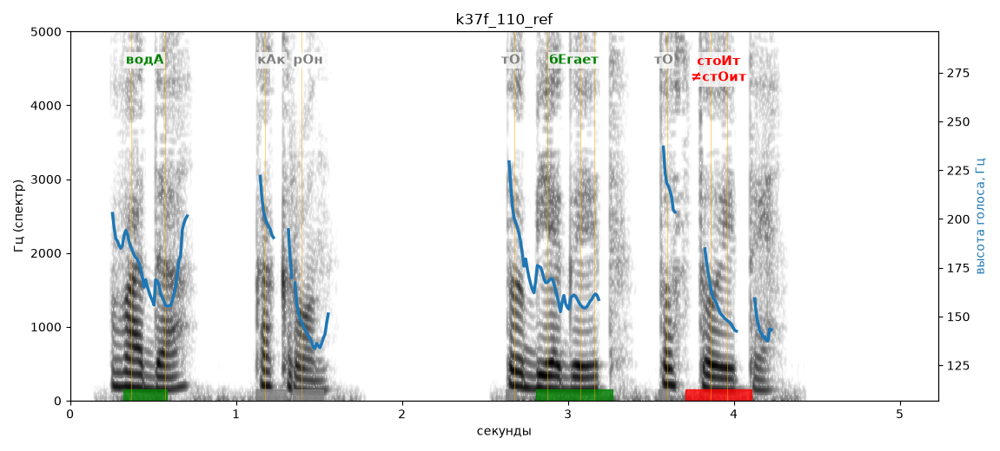

# k37f_110_ref

Голос: **edge:ru-RU-SvetlanaNeural** · длительность 5.2 с
Эталон: Вода — как Рон. То бегает, то стои́т.
Распознано: Вода, как рон. То бегает, то стоит ты.
Расхождения в словах: «стои т» → «стоит ты»

## Ударения
(где нужно: ruaccent)

| слово | нужно | у голоса | |
|---|---|---|---|
| вода | водА | водА | ✓ |
| бегает | бЕгает | бЕгает | ✓ |
| стоит | стоИт | стОит | ✗ ОШИБКА |

## Интонация
- ✓ «вода как рон.» — конец фразы понижается — звучит законченно
- ✓ «то бегает то стоит.» — конец фразы понижается — звучит законченно
- Диапазон голоса 7.3 полутонов (живо), средняя высота 163 Гц

## Паузы и темп
- паузы на своих местах
- Темп 5.9 слога/с (нормально)

_Синяя линия — высота голоса. Над словами заглавная буква — где ударение должно быть; красным — голос поставил не туда (уверенно), оранжевым — возможно._
