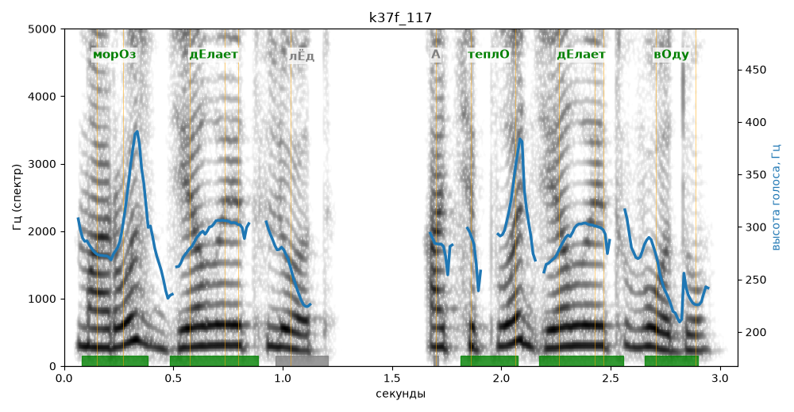

# k37f_117

Голос: **Филя, сборка 37f** · длительность 3.1 с
Эталон: Мороз делает лёд. А тепло делает воду.
Распознано: Мороз делает лёт, а тепло делает воду.
Расхождения в словах: «лед» → «лет»

## Ударения
(где нужно: ruaccent)

| слово | нужно | у голоса | |
|---|---|---|---|
| мороз | морОз | морОз | ✓ |
| делает | дЕлает | дЕлает | ✓ |
| тепло | теплО | теплО | ✓ |
| делает | дЕлает | дЕлает | ✓ |
| воду | вОду | вОду | ✓ |

## Интонация
- ✓ «мороз делает лёд.» — конец фразы понижается — звучит законченно
- ✓ «а тепло делает воду.» — конец фразы понижается — звучит законченно
- Диапазон голоса 7.1 полутонов (живо), средняя высота 284 Гц

## Паузы и темп
- паузы на своих местах
- Темп 6.0 слога/с (нормально)

_Синяя линия — высота голоса. Над словами заглавная буква — где ударение должно быть; красным — голос поставил не туда (уверенно), оранжевым — возможно._
