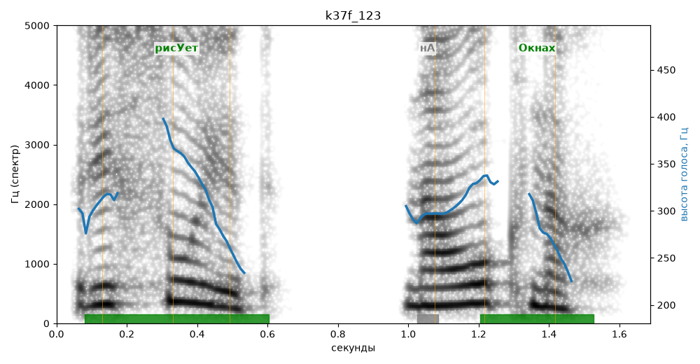

# k37f_123

Голос: **Филя, сборка 37f** · длительность 1.7 с
Эталон: Рисует? На окнах?
Распознано: рисует на окнах.
Слова: все совпали

## Ударения
(где нужно: ruaccent)

| слово | нужно | у голоса | |
|---|---|---|---|
| рисует | рисУет | рисУет | ✓ |
| окнах | Окнах | Окнах | ✓ |

## Интонация
- ✓ «рисует?» — вопросительный подъём на слове «рисует»
- ✗ «на окнах?» — нет вопросительного подъёма (самое высокое место — «окнах», в начале) — звучит как утверждение
- Диапазон голоса 7.1 полутонов (живо), средняя высота 303 Гц

## Паузы и темп
- паузы на своих местах
- Темп 5.9 слога/с (нормально)

_Синяя линия — высота голоса. Над словами заглавная буква — где ударение должно быть; красным — голос поставил не туда (уверенно), оранжевым — возможно._
