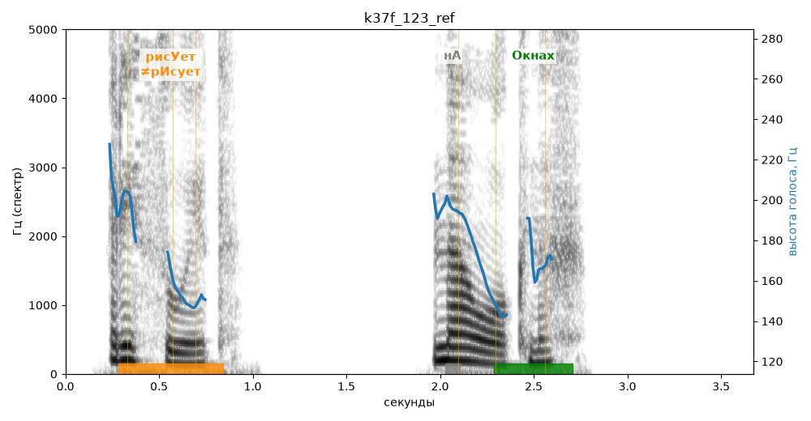

# k37f_123_ref

Голос: **edge:ru-RU-SvetlanaNeural** · длительность 3.7 с
Эталон: Рисует? На окнах?
Распознано: рисует на окнах
Слова: все совпали

## Ударения
(где нужно: ruaccent)

| слово | нужно | у голоса | |
|---|---|---|---|
| рисует | рисУет | рИсует | ✗? возможно — послушать |
| окнах | Окнах | Окнах | ✓ |

## Интонация
- ✗ «рисует?» — нет вопросительного подъёма (самое высокое место — «рисует», в начале) — звучит как утверждение
- ✗ «на окнах?» — нет вопросительного подъёма (самое высокое место — «на», в начале) — звучит как утверждение
- Диапазон голоса 5.9 полутонов (нормально), средняя высота 171 Гц

## Паузы и темп
- паузы на своих местах
- Темп 5.6 слога/с (нормально)

_Синяя линия — высота голоса. Над словами заглавная буква — где ударение должно быть; красным — голос поставил не туда (уверенно), оранжевым — возможно._
