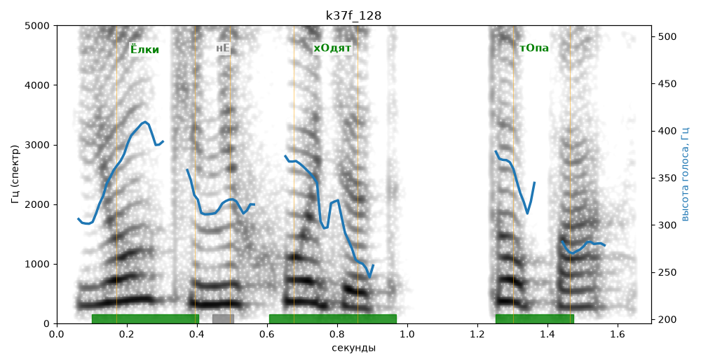

# k37f_128

Голос: **Филя, сборка 37f** · длительность 1.7 с
Эталон: Ёлки не ходят, Топа!
Распознано: Ёлки не ходят, топа.
Слова: все совпали

## Ударения
(где нужно: ruaccent)

| слово | нужно | у голоса | |
|---|---|---|---|
| ёлки | Ёлки | Ёлки | ✓ |
| ходят | хОдят | хОдят | ✓ |
| топа | тОпа | тОпа | ✓ |

## Интонация
- ✗ «ёлки не ходят топа!» — восклицание звучит ровно, без эмоции
- Диапазон голоса 7.2 полутонов (живо), средняя высота 324 Гц

## Паузы и темп
- паузы на своих местах
- Темп 6.4 слога/с (нормально)

_Синяя линия — высота голоса. Над словами заглавная буква — где ударение должно быть; красным — голос поставил не туда (уверенно), оранжевым — возможно._
