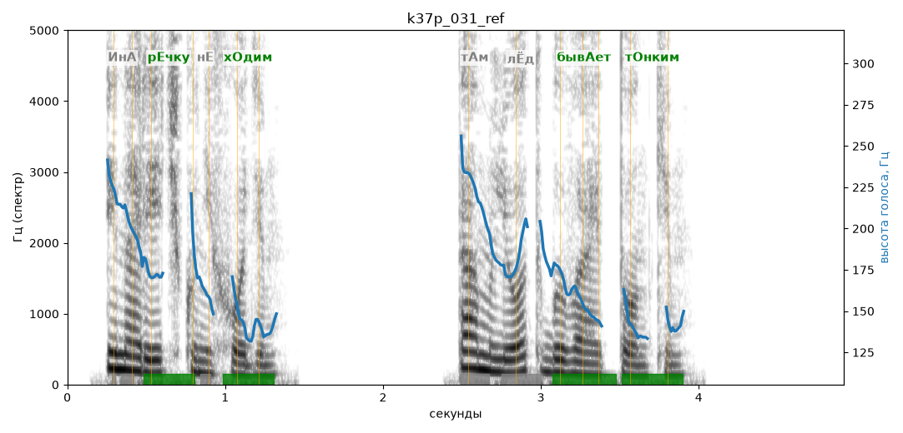

# k37p_031_ref

Голос: **edge:ru-RU-SvetlanaNeural** · длительность 4.9 с
Эталон: И на речку не ходим. Там лёд бывает тонким.
Распознано: И на речку не ходим. Там лёт бывает тонким.
Расхождения в словах: «лед» → «лет»

## Ударения
(где нужно: ruaccent)

| слово | нужно | у голоса | |
|---|---|---|---|
| речку | рЕчку | рЕчку | ✓ |
| ходим | хОдим | хОдим | ✓ |
| бывает | бывАет | бывАет | ✓ |
| тонким | тОнким | тОнким | ✓ |

## Интонация
- ✓ «и на речку не ходим.» — конец фразы понижается — звучит законченно
- ✓ «там лёд бывает тонким.» — конец фразы понижается — звучит законченно
- Диапазон голоса 9.2 полутонов (живо), средняя высота 171 Гц

## Паузы и темп
- паузы на своих местах
- Темп 5.8 слога/с (нормально)

_Синяя линия — высота голоса. Над словами заглавная буква — где ударение должно быть; красным — голос поставил не туда (уверенно), оранжевым — возможно._
