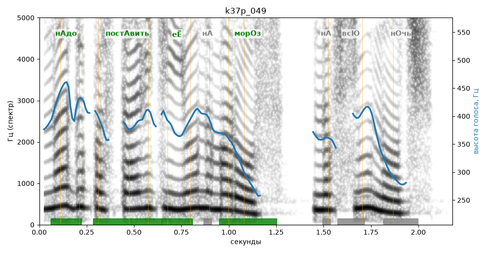

# k37p_049

Голос: **Пик, сборка 37f** · длительность 2.2 с
Эталон: Надо поставить её на мороз. На всю ночь.
Распознано: Надо поставить и уйдем на мороз, на всю ночь.
Расхождения в словах: «ее» → «и уйдем»

## Ударения
(где нужно: ruaccent)

| слово | нужно | у голоса | |
|---|---|---|---|
| надо | нАдо | нАдо | ✓ |
| поставить | постАвить | постАвить | ✓ |
| её | еЁ | еЁ | ✓ |
| мороз | морОз | морОз | ✓ |

## Интонация
- ✓ «надо поставить её на мороз.» — конец фразы понижается — звучит законченно
- ✓ «на всю ночь.» — конец фразы понижается — звучит законченно
- Диапазон голоса 7.5 полутонов (живо), средняя высота 380 Гц

## Паузы и темп
- паузы на своих местах
- Темп 7.7 слога/с (быстро)

_Синяя линия — высота голоса. Над словами заглавная буква — где ударение должно быть; красным — голос поставил не туда (уверенно), оранжевым — возможно._
