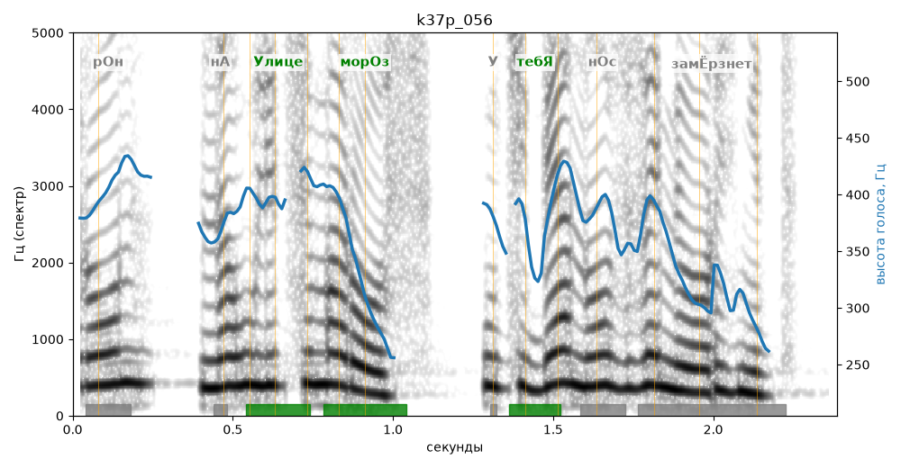

# k37p_056

Голос: **Пик, сборка 37f** · длительность 2.4 с
Эталон: Рон, на улице мороз. У тебя нос замёрзнет.
Распознано: Трон, на улицу Мороз, у тебя на зоне орнит.
Расхождения в словах: «рон» → «трон»; «улице» → «улицу»; «нос замерзнет» → «на зоне орнит»

## Ударения
(где нужно: ruaccent)

| слово | нужно | у голоса | |
|---|---|---|---|
| улице | Улице | Улице | ✓ |
| мороз | морОз | морОз | ✓ |
| тебя | тебЯ | тебЯ | ✓ |
| замёрзнет | замЁрзнет | зАмёрзнет | ? не разобрать |

## Интонация
- ✓ «рон на улице мороз.» — конец фразы понижается — звучит законченно
- ✓ «у тебя нос замёрзнет.» — конец фразы понижается — звучит законченно
- Диапазон голоса 7.2 полутонов (живо), средняя высота 380 Гц

## Паузы и темп
- паузы на своих местах
- Темп 8.4 слога/с (быстро)

_Синяя линия — высота голоса. Над словами заглавная буква — где ударение должно быть; красным — голос поставил не туда (уверенно), оранжевым — возможно._
