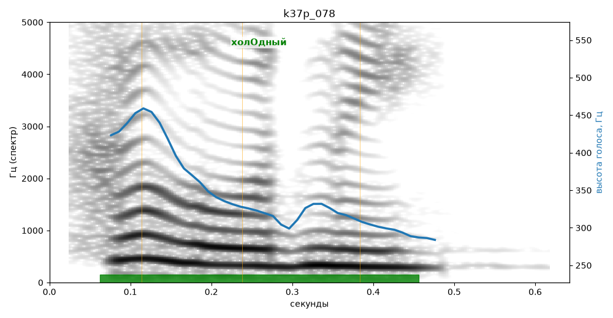

# k37p_078

Голос: **Пик, сборка 37f** · длительность 0.6 с
Эталон: Холодный!
Распознано: Холодный!
Слова: все совпали

## Ударения
(где нужно: ruaccent)

| слово | нужно | у голоса | |
|---|---|---|---|
| холодный | холОдный | холОдный | ✓ |

## Интонация
- ✗ «холодный!» — восклицание звучит ровно, без эмоции
- Диапазон голоса 7.9 полутонов (живо), средняя высота 326 Гц

## Паузы и темп
- паузы на своих местах
- Темп 7.6 слога/с (быстро)

_Синяя линия — высота голоса. Над словами заглавная буква — где ударение должно быть; красным — голос поставил не туда (уверенно), оранжевым — возможно._
