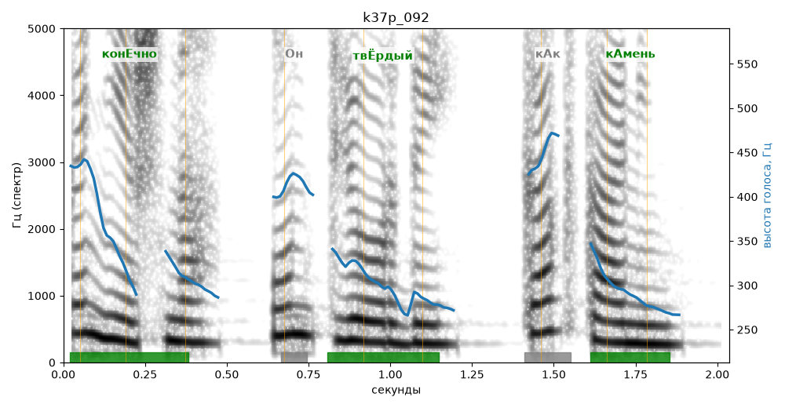

# k37p_092

Голос: **Пик, сборка 37f** · длительность 2.0 с
Эталон: Конечно. Он твёрдый. Как камень.
Распознано: Конечно, он пёрды, как камень.
Расхождения в словах: «твердый» → «перды»

## Ударения
(где нужно: ruaccent)

| слово | нужно | у голоса | |
|---|---|---|---|
| конечно | конЕчно | конЕчно | ✓ |
| твёрдый | твЁрдый | твЁрдый | ✓ |
| камень | кАмень | кАмень | ✓ |

## Интонация
- ✗ «конечно.» — конец фразы не понижается — звучит незаконченно / как перечисление
- ✗ «он твёрдый.» — конец фразы не понижается — звучит незаконченно / как перечисление
- ✗ «как камень.» — конец фразы не понижается — звучит незаконченно / как перечисление
- Диапазон голоса 8.5 полутонов (живо), средняя высота 309 Гц

## Паузы и темп
- паузы на своих местах
- Темп 7.0 слога/с (быстро)

_Синяя линия — высота голоса. Над словами заглавная буква — где ударение должно быть; красным — голос поставил не туда (уверенно), оранжевым — возможно._
