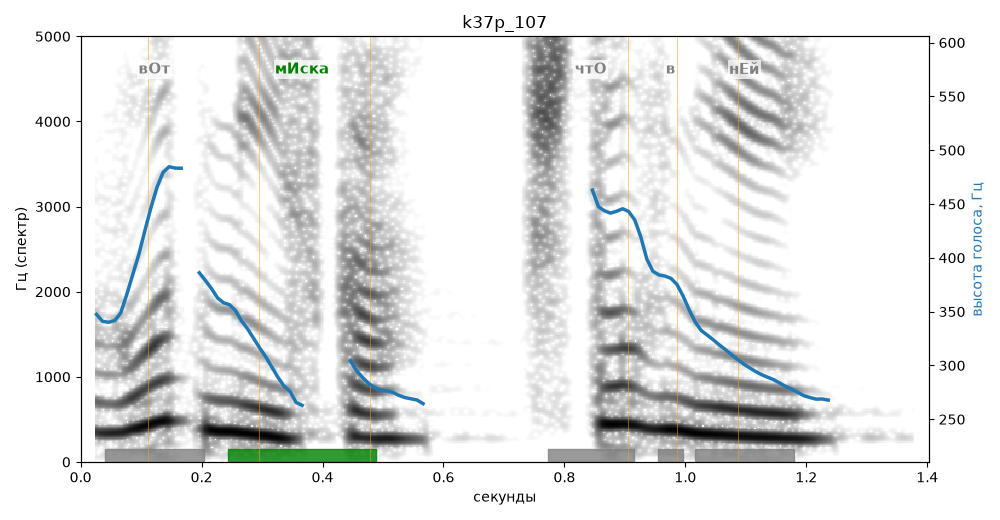

# k37p_107

Голос: **Пик, сборка 37f** · длительность 1.4 с
Эталон: Вот миска. Что в ней?
Распознано: Вот миска, что в ней.
Слова: все совпали

## Ударения
(где нужно: ruaccent)

| слово | нужно | у голоса | |
|---|---|---|---|
| миска | мИска | мИска | ✓ |

## Интонация
- ✗ «вот миска.» — конец фразы не понижается — звучит незаконченно / как перечисление
- ✓ «что в ней?» — конец фразы понижается — звучит законченно
- Диапазон голоса 9.5 полутонов (живо), средняя высота 330 Гц

## Паузы и темп
- паузы на своих местах
- Темп 7.0 слога/с (быстро)

_Синяя линия — высота голоса. Над словами заглавная буква — где ударение должно быть; красным — голос поставил не туда (уверенно), оранжевым — возможно._
