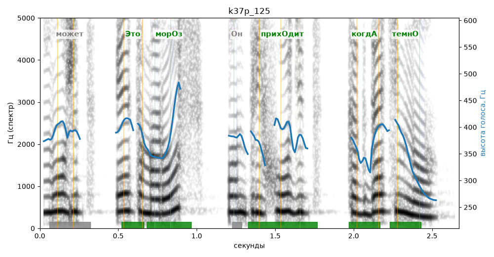

# k37p_125

Голос: **Пик, сборка 37f** · длительность 2.7 с
Эталон: Может, это мороз? Он приходит, когда темно.
Распознано: Может, это Мороз? Он приходит, когда кино.
Расхождения в словах: «темно» → «кино»

## Ударения
(где нужно: ruaccent)

| слово | нужно | у голоса | |
|---|---|---|---|
| может | может | мОжет | нет эталона |
| это | Это | Это | ✓ |
| мороз | морОз | морОз | ✓ |
| приходит | прихОдит | прихОдит | ✓ |
| когда | когдА | когдА | ✓ |
| темно | темнО | темнО | ✓ |

## Интонация
- ✗ «может это мороз?» — нет вопросительного подъёма (самое высокое место — «это», в начале) — звучит как утверждение
- ✓ «он приходит когда темно.» — конец фразы понижается — звучит законченно
- Диапазон голоса 7.0 полутонов (живо), средняя высота 380 Гц

## Паузы и темп
- паузы на своих местах
- Темп 8.2 слога/с (быстро)

_Синяя линия — высота голоса. Над словами заглавная буква — где ударение должно быть; красным — голос поставил не туда (уверенно), оранжевым — возможно._
