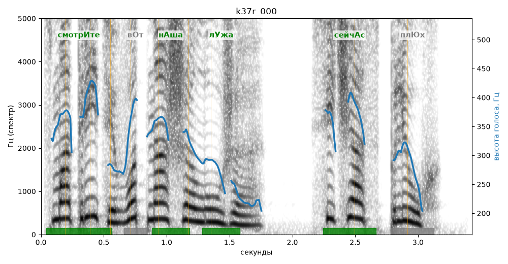

# k37r_000

Голос: **Рон, сборка 37f** · длительность 3.4 с
Эталон: Смотрите, вот наша лужа. Сейчас — плюх!
Распознано: Смотрите, вот наша лужа. Сейчас плюх.
Слова: все совпали

## Ударения
(где нужно: ruaccent)

| слово | нужно | у голоса | |
|---|---|---|---|
| смотрите | смотрИте | смотрИте | ✓ |
| наша | нАша | нАша | ✓ |
| лужа | лУжа | лУжа | ✓ |
| сейчас | сейчАс | сейчАс | ✓ |

## Интонация
- ✓ «смотрите вот наша лужа.» — конец фразы понижается — звучит законченно
- ✗ «сейчас плюх!» — восклицание звучит ровно, без эмоции
- Диапазон голоса 10.8 полутонов (живо), средняя высота 315 Гц

## Паузы и темп
- паузы на своих местах
- Темп 4.5 слога/с (нормально)

_Синяя линия — высота голоса. Над словами заглавная буква — где ударение должно быть; красным — голос поставил не туда (уверенно), оранжевым — возможно._
