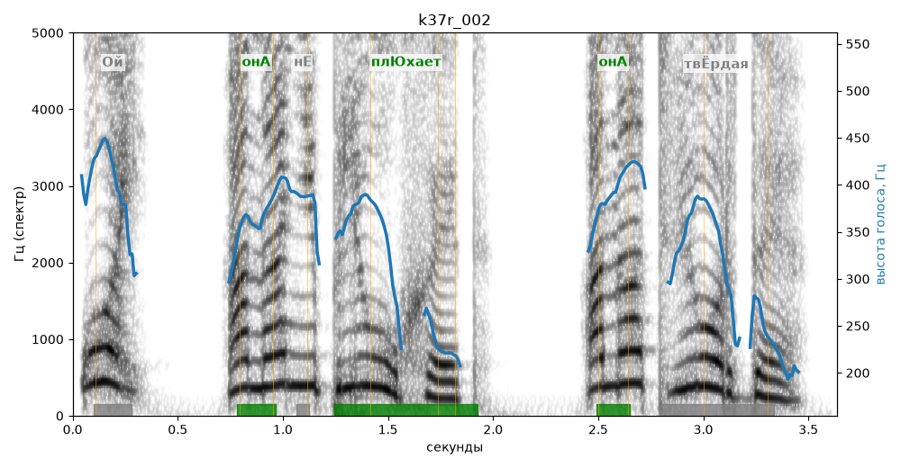

# k37r_002

Голос: **Рон, сборка 37f** · длительность 3.6 с
Эталон: Ой! Она не плюхает! Она твёрдая!
Распознано: Ой, она не плюхает. Она твердая.
Слова: все совпали

## Ударения
(где нужно: ruaccent)

| слово | нужно | у голоса | |
|---|---|---|---|
| она | онА | онА | ✓ |
| плюхает | плЮхает | плЮхает | ✓ |
| она | онА | онА | ✓ |
| твёрдая | твЁрдая | — | ? |

## Интонация
- ✗ «она не плюхает!» — восклицание звучит ровно, без эмоции
- ✓ «она твёрдая!» — выделено слово «она» (+2.0 пт)
- Диапазон голоса 11.7 полутонов (живо), средняя высота 364 Гц

## Паузы и темп
- паузы на своих местах
- Темп 5.1 слога/с (нормально)

_Синяя линия — высота голоса. Над словами заглавная буква — где ударение должно быть; красным — голос поставил не туда (уверенно), оранжевым — возможно._
