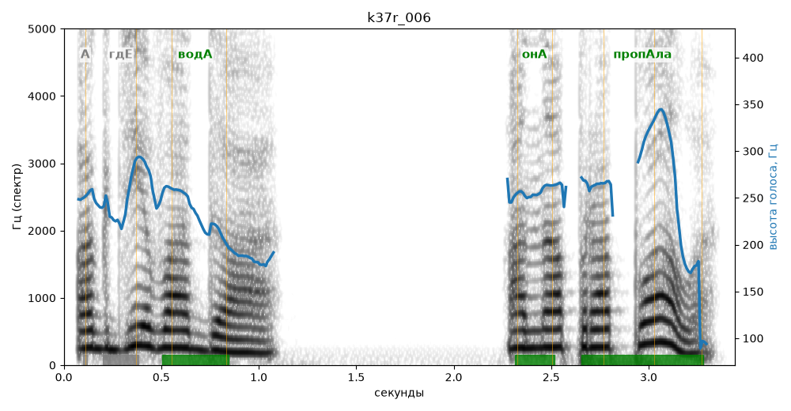

# k37r_006

Голос: **Рон, сборка 37f** · длительность 3.4 с
Эталон: А где вода? Она пропала?
Распознано: А где вода? Она пропала?
Слова: все совпали

## Ударения
(где нужно: ruaccent)

| слово | нужно | у голоса | |
|---|---|---|---|
| вода | водА | водА | ✓ |
| она | онА | онА | ✓ |
| пропала | пропАла | пропАла | ✓ |

## Интонация
- ✗ «а где вода?» — нет вопросительного подъёма (самое высокое место — «где», в начале) — звучит как утверждение
- ✓ «она пропала?» — вопросительный подъём на слове «пропала»
- Диапазон голоса 10.4 полутонов (живо), средняя высота 251 Гц

## Паузы и темп
- паузы на своих местах
- Темп 5.3 слога/с (нормально)

_Синяя линия — высота голоса. Над словами заглавная буква — где ударение должно быть; красным — голос поставил не туда (уверенно), оранжевым — возможно._
