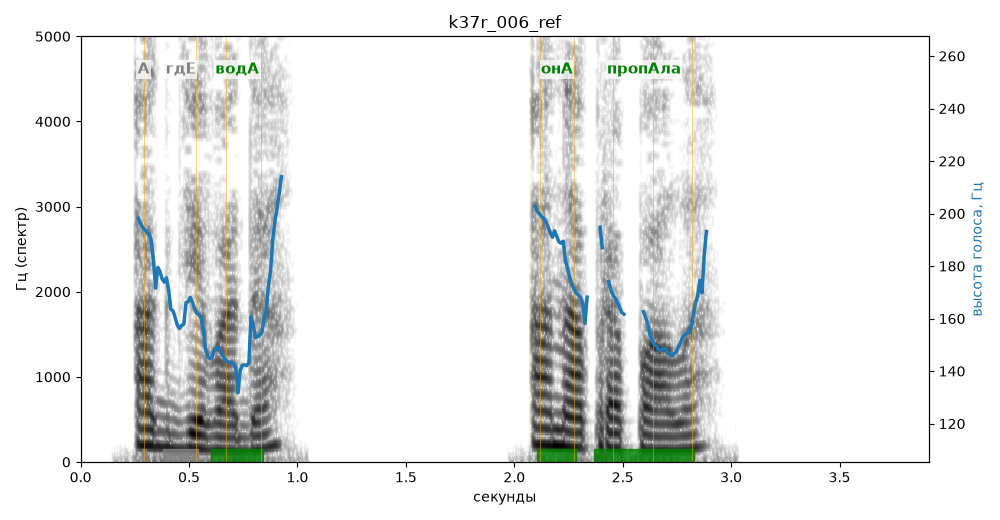

# k37r_006_ref

Голос: **edge:ru-RU-SvetlanaNeural** · длительность 3.9 с
Эталон: А где вода? Она пропала?
Распознано: А где вода? Она пропала.
Слова: все совпали

## Ударения
(где нужно: ruaccent)

| слово | нужно | у голоса | |
|---|---|---|---|
| вода | водА | водА | ✓ |
| она | онА | онА | ✓ |
| пропала | пропАла | пропАла | ✓ |

## Интонация
- ✗ «а где вода?» — нет вопросительного подъёма (самое высокое место — «а», в начале) — звучит как утверждение
- ✗ «она пропала?» — нет вопросительного подъёма (самое высокое место — «она», в начале) — звучит как утверждение
- Диапазон голоса 5.7 полутонов (нормально), средняя высота 163 Гц

## Паузы и темп
- паузы на своих местах
- Темп 7.0 слога/с (быстро)

_Синяя линия — высота голоса. Над словами заглавная буква — где ударение должно быть; красным — голос поставил не туда (уверенно), оранжевым — возможно._
