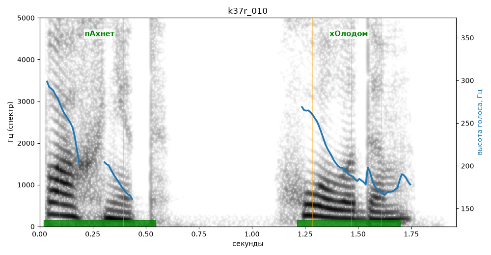

# k37r_010

Голос: **Рон, сборка 37f** · длительность 2.0 с
Эталон: Пахнет… холодом.
Распознано: Пахнет. Холодом.
Слова: все совпали

## Ударения
(где нужно: ruaccent)

| слово | нужно | у голоса | |
|---|---|---|---|
| пахнет | пАхнет | пАхнет | ✓ |
| холодом | хОлодом | хОлодом | ✓ |

## Интонация
- ✗ «холодом.» — конец фразы не понижается — звучит незаконченно / как перечисление
- Диапазон голоса 9.1 полутонов (живо), средняя высота 196 Гц

## Паузы и темп
- паузы на своих местах
- Темп 4.9 слога/с (нормально)

_Синяя линия — высота голоса. Над словами заглавная буква — где ударение должно быть; красным — голос поставил не туда (уверенно), оранжевым — возможно._
