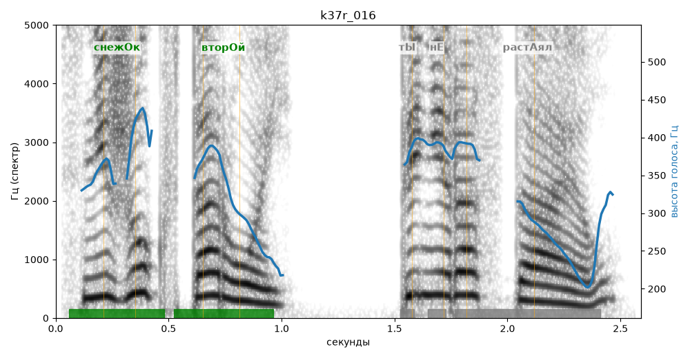

# k37r_016

Голос: **Рон, сборка 37f** · длительность 2.6 с
Эталон: Снежок Второй! Ты не растаял!
Распознано: Снежук второй. Ты не растаял.
Расхождения в словах: «снежок» → «снежук»

## Ударения
(где нужно: ruaccent)

| слово | нужно | у голоса | |
|---|---|---|---|
| снежок | снежОк | снежОк | ✓ |
| второй | вторОй | вторОй | ✓ |
| растаял | растАял | — | ? |

## Интонация
- ✓ «снежок второй!» — выделено слово «снежок» (+2.2 пт)
- ✗ «ты не растаял!» — восклицание звучит ровно, без эмоции
- Диапазон голоса 10.8 полутонов (живо), средняя высота 338 Гц

## Паузы и темп
- паузы на своих местах
- Темп 4.5 слога/с (нормально)

_Синяя линия — высота голоса. Над словами заглавная буква — где ударение должно быть; красным — голос поставил не туда (уверенно), оранжевым — возможно._
