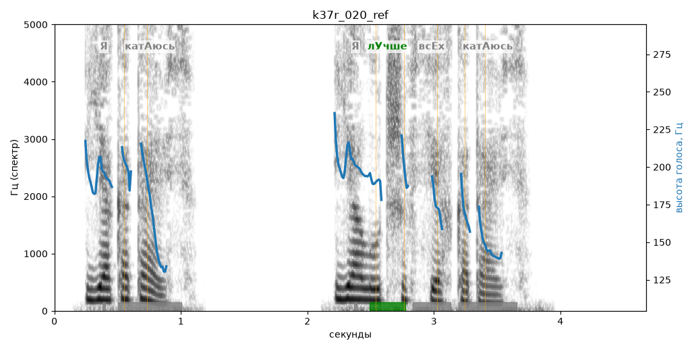

# k37r_020_ref

Голос: **edge:ru-RU-SvetlanaNeural** · длительность 4.7 с
Эталон: Я катаюсь! Я лучше всех катаюсь!
Распознано: Я катаюсь. Я лучше всех катаюсь.
Слова: все совпали

## Ударения
(где нужно: ruaccent)

| слово | нужно | у голоса | |
|---|---|---|---|
| катаюсь | катАюсь | — | ? |
| лучше | лУчше | лУчше | ✓ |
| катаюсь | катАюсь | — | ? |

## Интонация
- ✗ «я лучше всех катаюсь!» — восклицание звучит ровно, без эмоции
- Диапазон голоса 7.5 полутонов (живо), средняя высота 191 Гц

## Паузы и темп
- паузы на своих местах
- Темп 3.7 слога/с (медленно)

_Синяя линия — высота голоса. Над словами заглавная буква — где ударение должно быть; красным — голос поставил не туда (уверенно), оранжевым — возможно._
