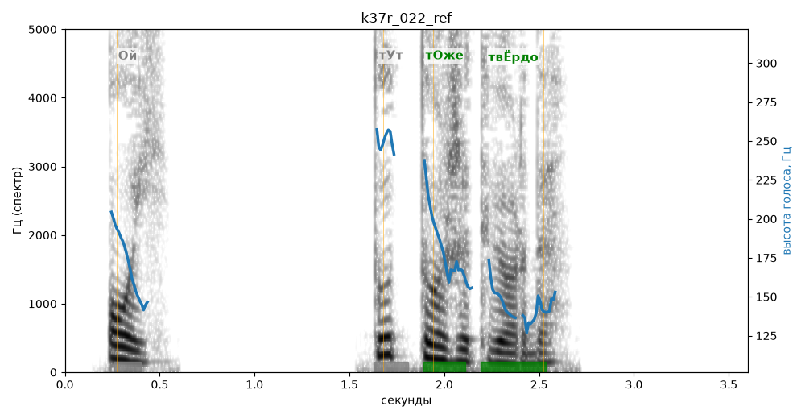

# k37r_022_ref

Голос: **edge:ru-RU-SvetlanaNeural** · длительность 3.6 с
Эталон: Ой. Тут тоже твёрдо.
Распознано: Ой, тут тоже тверда.
Расхождения в словах: «твердо» → «тверда»

## Ударения
(где нужно: ruaccent)

| слово | нужно | у голоса | |
|---|---|---|---|
| тоже | тОже | тОже | ✓ |
| твёрдо | твЁрдо | твЁрдо | ✓ |

## Интонация
- ✓ «тут тоже твёрдо.» — конец фразы понижается — звучит законченно
- Диапазон голоса 10.6 полутонов (живо), средняя высота 161 Гц

## Паузы и темп
- паузы на своих местах
- Темп 5.7 слога/с (нормально)

_Синяя линия — высота голоса. Над словами заглавная буква — где ударение должно быть; красным — голос поставил не туда (уверенно), оранжевым — возможно._
