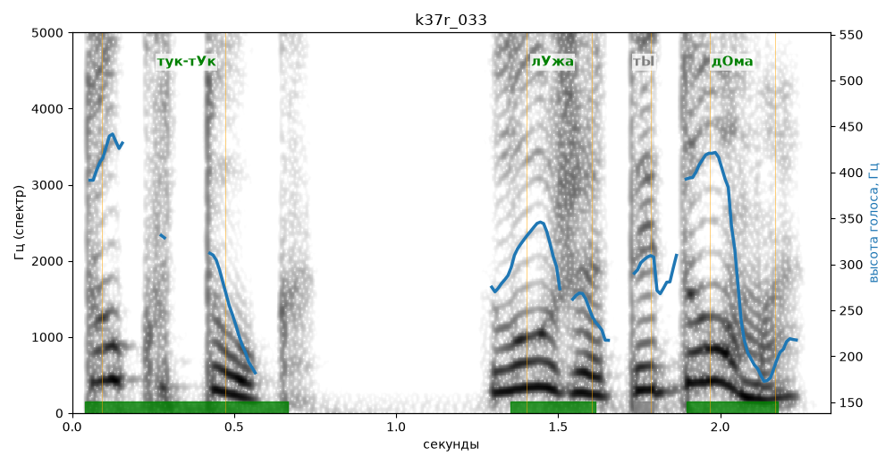

# k37r_033

Голос: **Рон, сборка 37f** · длительность 2.3 с
Эталон: Тук-тук! Лужа, ты дома?
Распознано: Тук-тук! Ложа ты дома!
Расхождения в словах: «лужа» → «ложа»

## Ударения
(где нужно: ruaccent)

| слово | нужно | у голоса | |
|---|---|---|---|
| тук-тук | тук-тУк | тук-тУк | ✓ |
| лужа | лУжа | лУжа | ✓ |
| дома | дОма | дОма | ✓ |

## Интонация
- ✓ «лужа ты дома?» — вопросительный подъём на слове «дома»
- Диапазон голоса 14.2 полутонов (живо), средняя высота 294 Гц

## Паузы и темп
- паузы на своих местах
- Темп 4.8 слога/с (нормально)

_Синяя линия — высота голоса. Над словами заглавная буква — где ударение должно быть; красным — голос поставил не туда (уверенно), оранжевым — возможно._
