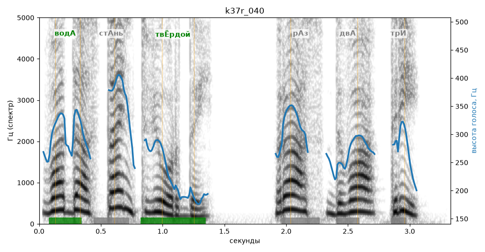

# k37r_040

Голос: **Рон, сборка 37f** · длительность 3.3 с
Эталон: Вода, стань твёрдой! Раз, два, три!
Распознано: Вода станет вердой. Раз, два, три.
Расхождения в словах: «стань твердой» → «станет вердой»

## Ударения
(где нужно: ruaccent)

| слово | нужно | у голоса | |
|---|---|---|---|
| вода | водА | водА | ✓ |
| твёрдой | твЁрдой | твЁрдой | ✓ |

## Интонация
- ✓ «вода стань твёрдой!» — выделено слово «стань» (+4.7 пт)
- ✓ «раз два три!» — выделено слово «раз» (+2.2 пт)
- Диапазон голоса 12.1 полутонов (живо), средняя высота 279 Гц

## Паузы и темп
- паузы на своих местах
- Темп 4.0 слога/с (нормально)

_Синяя линия — высота голоса. Над словами заглавная буква — где ударение должно быть; красным — голос поставил не туда (уверенно), оранжевым — возможно._
