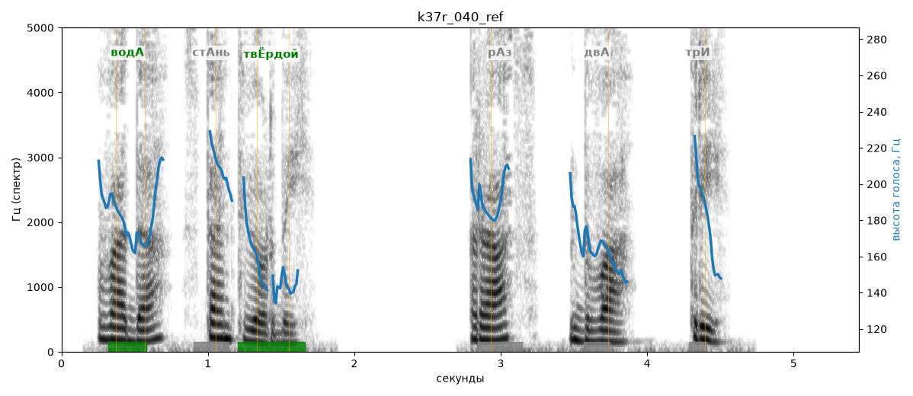

# k37r_040_ref

Голос: **edge:ru-RU-SvetlanaNeural** · длительность 5.4 с
Эталон: Вода, стань твёрдой! Раз, два, три!
Распознано: Вода стандвёрдой. Раз, два, три.
Расхождения в словах: «стань твердой» → «стандвердой»

## Ударения
(где нужно: ruaccent)

| слово | нужно | у голоса | |
|---|---|---|---|
| вода | водА | водА | ✓ |
| твёрдой | твЁрдой | твЁрдой | ✓ |

## Интонация
- ✓ «вода стань твёрдой!» — выделено слово «стань» (+3.4 пт)
- ✗ «раз два три!» — восклицание звучит ровно, без эмоции
- Диапазон голоса 7.0 полутонов (живо), средняя высота 176 Гц

## Паузы и темп
- паузы на своих местах
- Темп 4.9 слога/с (нормально)

_Синяя линия — высота голоса. Над словами заглавная буква — где ударение должно быть; красным — голос поставил не туда (уверенно), оранжевым — возможно._
