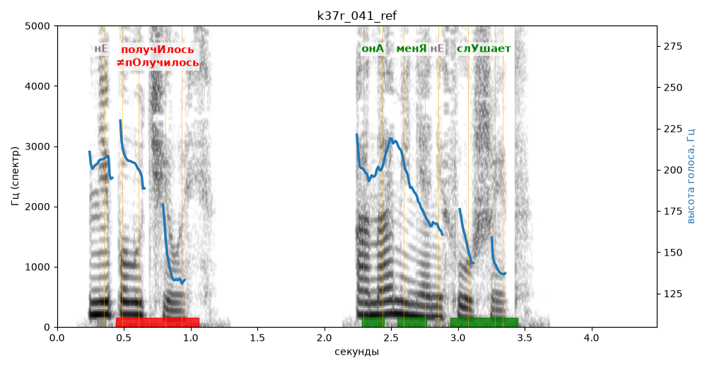

# k37r_041_ref

Голос: **edge:ru-RU-SvetlanaNeural** · длительность 4.5 с
Эталон: Не получилось. Она меня не слушает.
Распознано: Не получилось. Она меня не слушает.
Слова: все совпали

## Ударения
(где нужно: ruaccent)

| слово | нужно | у голоса | |
|---|---|---|---|
| получилось | получИлось | пОлучилось | ✗ ОШИБКА |
| она | онА | онА | ✓ |
| меня | менЯ | менЯ | ✓ |
| слушает | слУшает | слУшает | ✓ |

## Интонация
- ✓ «не получилось.» — конец фразы понижается — звучит законченно
- ✓ «она меня не слушает.» — конец фразы понижается — звучит законченно
- Диапазон голоса 8.3 полутонов (живо), средняя высота 195 Гц

## Паузы и темп
- паузы на своих местах
- Темп 6.8 слога/с (быстро)

_Синяя линия — высота голоса. Над словами заглавная буква — где ударение должно быть; красным — голос поставил не туда (уверенно), оранжевым — возможно._
