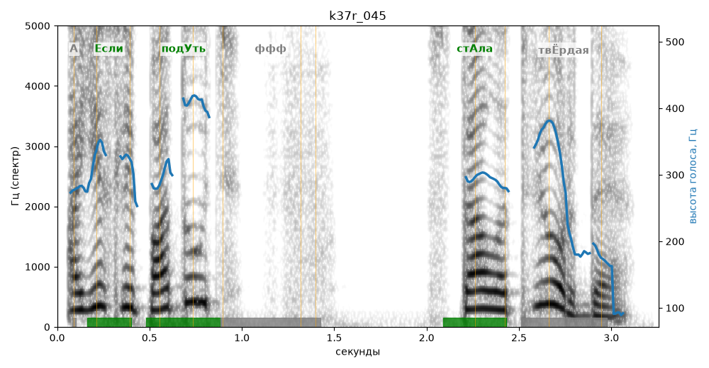

# k37r_045

Голос: **Рон, сборка 37f** · длительность 3.3 с
Эталон: А если подуть? Ффф! Стала твёрдая?
Распознано: А если подуть, стало твердое.
Расхождения в словах: «ффф стала твердая» → «стало твердое»

## Ударения
(где нужно: ruaccent)

| слово | нужно | у голоса | |
|---|---|---|---|
| если | Если | Если | ✓ |
| подуть | подУть | подУть | ✓ |
| стала | стАла | стАла | ✓ |
| твёрдая | твЁрдая | — | ? |

## Интонация
- ✓ «а если подуть?» — вопросительный подъём на слове «подуть»
- ✓ «стала твёрдая?» — вопросительный подъём на слове «твёрдая»
- Диапазон голоса 16.1 полутонов (живо), средняя высота 294 Гц

## Паузы и темп
- после «подуть?» пауза всего 0.00 с — фразы слипаются
- Темп 5.4 слога/с (нормально)

_Синяя линия — высота голоса. Над словами заглавная буква — где ударение должно быть; красным — голос поставил не туда (уверенно), оранжевым — возможно._
