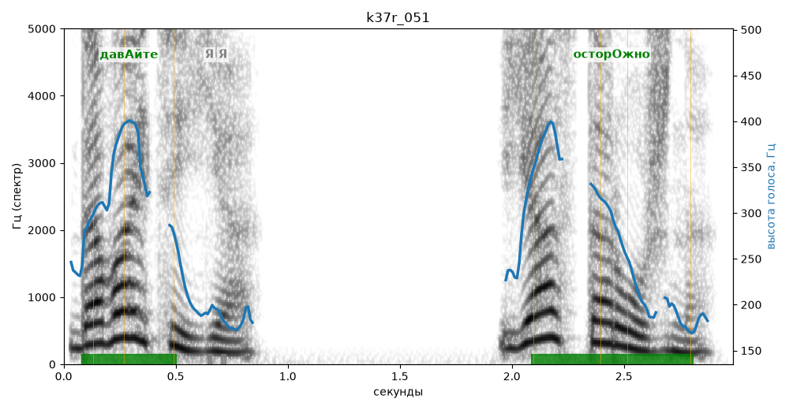

# k37r_051

Голос: **Рон, сборка 37f** · длительность 3.0 с
Эталон: Давайте я! Я осторожно!
Распознано: Давайте я. Я осторожно.
Слова: все совпали

## Ударения
(где нужно: ruaccent)

| слово | нужно | у голоса | |
|---|---|---|---|
| давайте | давАйте | давАйте | ✓ |
| осторожно | осторОжно | осторОжно | ✓ |

## Интонация
- ✓ «давайте я!» — выделено слово «давайте» (+4.6 пт)
- ✗ «я осторожно!» — восклицание звучит ровно, без эмоции
- Диапазон голоса 14.1 полутонов (живо), средняя высота 242 Гц

## Паузы и темп
- после «я!» пауза всего 0.04 с — фразы слипаются
- лишняя пауза 1.36 с между «я» и «осторожно»
- Темп 5.1 слога/с (нормально)

_Синяя линия — высота голоса. Над словами заглавная буква — где ударение должно быть; красным — голос поставил не туда (уверенно), оранжевым — возможно._
