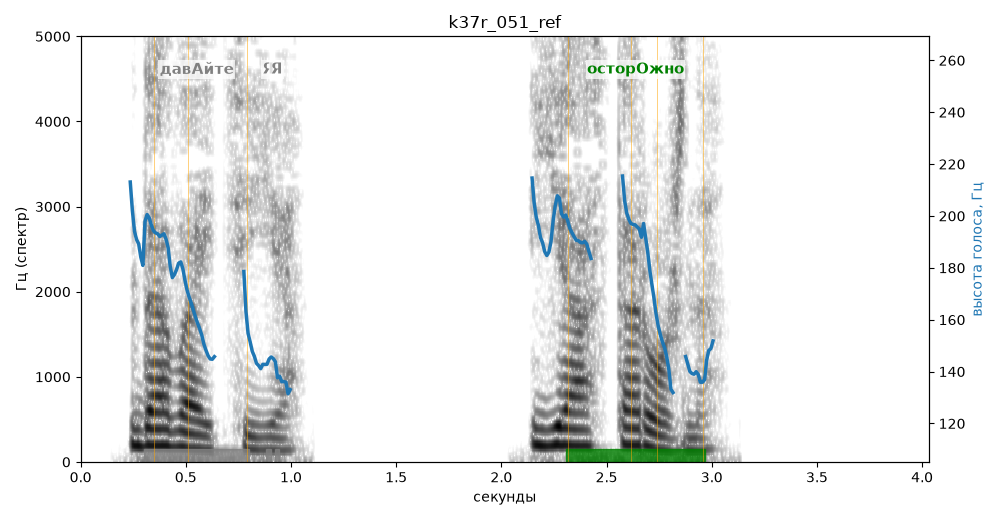

# k37r_051_ref

Голос: **edge:ru-RU-SvetlanaNeural** · длительность 4.0 с
Эталон: Давайте я! Я осторожно!
Распознано: Давайте я. Я осторожно.
Слова: все совпали

## Ударения
(где нужно: ruaccent)

| слово | нужно | у голоса | |
|---|---|---|---|
| давайте | давАйте | дАвайте | ? не разобрать |
| осторожно | осторОжно | осторОжно | ✓ |

## Интонация
- ✗ «давайте я!» — восклицание звучит ровно, без эмоции
- ✗ «я осторожно!» — восклицание звучит ровно, без эмоции
- Диапазон голоса 7.0 полутонов (живо), средняя высота 179 Гц

## Паузы и темп
- после «я!» пауза всего 0.02 с — фразы слипаются
- лишняя пауза 1.36 с между «я» и «осторожно»
- Темп 5.4 слога/с (нормально)

_Синяя линия — высота голоса. Над словами заглавная буква — где ударение должно быть; красным — голос поставил не туда (уверенно), оранжевым — возможно._
