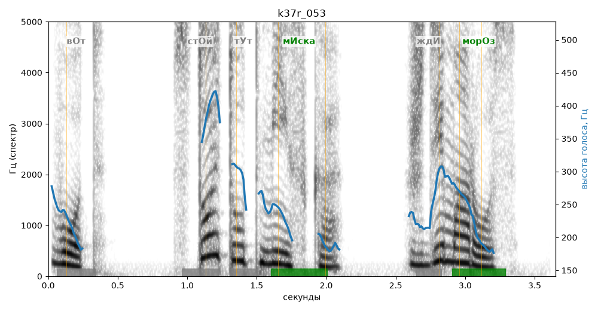

# k37r_053

Голос: **Рон, сборка 37f** · длительность 3.6 с
Эталон: Вот. Стой тут, миска. Жди мороз.
Распознано: Вот, стой тут миска, ждемороз.
Расхождения в словах: «жди мороз» → «ждемороз»

## Ударения
(где нужно: ruaccent)

| слово | нужно | у голоса | |
|---|---|---|---|
| миска | мИска | мИска | ✓ |
| мороз | морОз | морОз | ✓ |

## Интонация
- ✓ «стой тут миска.» — конец фразы понижается — звучит законченно
- ✓ «жди мороз.» — конец фразы понижается — звучит законченно
- Диапазон голоса 13.4 полутонов (живо), средняя высота 240 Гц

## Паузы и темп
- паузы на своих местах
- Темп 4.1 слога/с (нормально)

_Синяя линия — высота голоса. Над словами заглавная буква — где ударение должно быть; красным — голос поставил не туда (уверенно), оранжевым — возможно._
