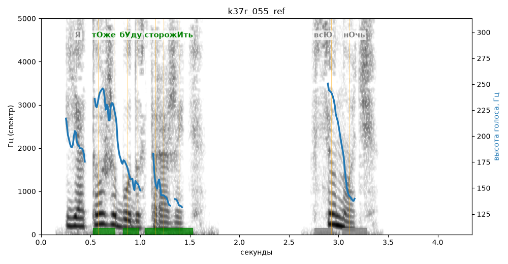

# k37r_055_ref

Голос: **edge:ru-RU-SvetlanaNeural** · длительность 4.3 с
Эталон: Я тоже буду сторожить. Всю ночь!
Распознано: Я тоже буду старожить. Всю ночь.
Расхождения в словах: «сторожить» → «старожить»

## Ударения
(где нужно: ruaccent)

| слово | нужно | у голоса | |
|---|---|---|---|
| тоже | тОже | тОже | ✓ |
| буду | бУду | бУду | ✓ |
| сторожить | сторожИть | сторожИть | ✓ |

## Интонация
- ✓ «я тоже буду сторожить.» — конец фразы понижается — звучит законченно
- Диапазон голоса 10.1 полутонов (живо), средняя высота 183 Гц

## Паузы и темп
- паузы на своих местах
- Темп 5.3 слога/с (нормально)

_Синяя линия — высота голоса. Над словами заглавная буква — где ударение должно быть; красным — голос поставил не туда (уверенно), оранжевым — возможно._
