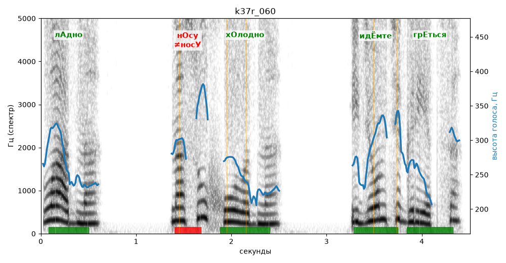

# k37r_060

Голос: **Рон, сборка 37f** · длительность 4.5 с
Эталон: Ладно. Носу холодно. Идёмте греться.
Распознано: Ладно, на су холодно. Идем тегреться.
Расхождения в словах: «носу» → «на су»; «идемте греться» → «идем тегреться»

## Ударения
(где нужно: ruaccent)

| слово | нужно | у голоса | |
|---|---|---|---|
| ладно | лАдно | лАдно | ✓ |
| носу | нОсу | носУ | ✗ ОШИБКА |
| холодно | хОлодно | хОлодно | ✓ |
| идёмте | идЁмте | идЁмте | ✓ |
| греться | грЕться | грЕться | ✓ |

## Интонация
- ✗ «носу холодно.» — конец фразы не понижается — звучит незаконченно / как перечисление
- ✓ «идёмте греться.» — конец фразы понижается — звучит законченно
- Диапазон голоса 7.6 полутонов (живо), средняя высота 266 Гц

## Паузы и темп
- паузы на своих местах
- Темп 5.3 слога/с (нормально)

_Синяя линия — высота голоса. Над словами заглавная буква — где ударение должно быть; красным — голос поставил не туда (уверенно), оранжевым — возможно._
