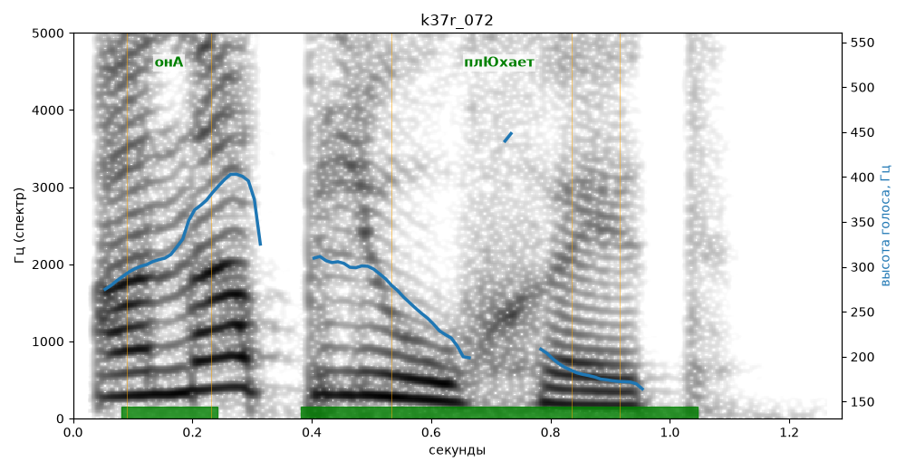

# k37r_072

Голос: **Рон, сборка 37f** · длительность 1.3 с
Эталон: Она плюхает!
Распознано: Она плюхает.
Слова: все совпали

## Ударения
(где нужно: ruaccent)

| слово | нужно | у голоса | |
|---|---|---|---|
| она | онА | онА | ✓ |
| плюхает | плЮхает | плЮхает | ✓ |

## Интонация
- ✓ «она плюхает!» — выделено слово «она» (+4.9 пт)
- Диапазон голоса 14.6 полутонов (живо), средняя высота 291 Гц

## Паузы и темп
- паузы на своих местах
- Темп 5.2 слога/с (нормально)

_Синяя линия — высота голоса. Над словами заглавная буква — где ударение должно быть; красным — голос поставил не туда (уверенно), оранжевым — возможно._
