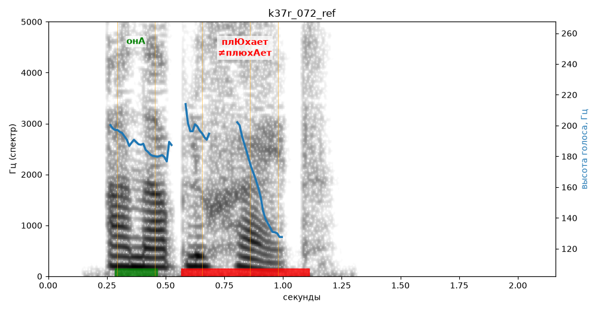

# k37r_072_ref

Голос: **edge:ru-RU-SvetlanaNeural** · длительность 2.2 с
Эталон: Она плюхает!
Распознано: Она оплюхает.
Расхождения в словах: «плюхает» → «оплюхает»

## Ударения
(где нужно: ruaccent)

| слово | нужно | у голоса | |
|---|---|---|---|
| она | онА | онА | ✓ |
| плюхает | плЮхает | плюхАет | ✗ ОШИБКА |

## Интонация
- ✗ «она плюхает!» — восклицание звучит ровно, без эмоции
- Диапазон голоса 7.5 полутонов (живо), средняя высота 188 Гц

## Паузы и темп
- паузы на своих местах
- Темп 6.0 слога/с (нормально)

_Синяя линия — высота голоса. Над словами заглавная буква — где ударение должно быть; красным — голос поставил не туда (уверенно), оранжевым — возможно._
