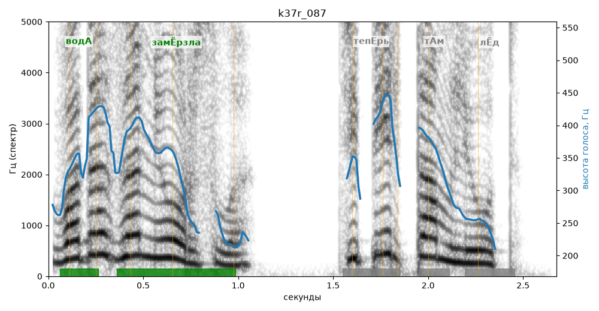

# k37r_087

Голос: **Рон, сборка 37f** · длительность 2.7 с
Эталон: Вода замёрзла! Теперь там лёд!
Распознано: Вода замёрзла. Теперь там лёт.
Расхождения в словах: «лед» → «лет»

## Ударения
(где нужно: ruaccent)

| слово | нужно | у голоса | |
|---|---|---|---|
| вода | водА | водА | ✓ |
| замёрзла | замЁрзла | замЁрзла | ✓ |
| теперь | тепЕрь | — | ? |

## Интонация
- ✓ «вода замёрзла!» — выделено слово «вода» (+2.7 пт)
- ✓ «теперь там лёд!» — выделено слово «теперь» (+2.8 пт)
- Диапазон голоса 11.5 полутонов (живо), средняя высота 338 Гц

## Паузы и темп
- паузы на своих местах
- Темп 5.5 слога/с (нормально)

_Синяя линия — высота голоса. Над словами заглавная буква — где ударение должно быть; красным — голос поставил не туда (уверенно), оранжевым — возможно._
