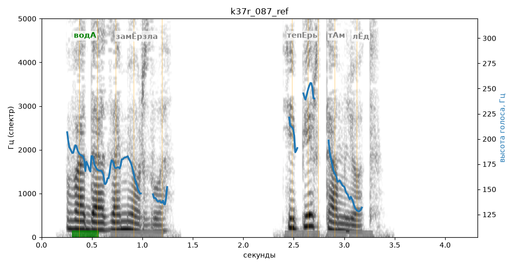

# k37r_087_ref

Голос: **edge:ru-RU-SvetlanaNeural** · длительность 4.3 с
Эталон: Вода замёрзла! Теперь там лёд!
Распознано: Вода замерзла. Теперь там лёт.
Расхождения в словах: «лед» → «лет»

## Ударения
(где нужно: ruaccent)

| слово | нужно | у голоса | |
|---|---|---|---|
| вода | водА | водА | ✓ |
| замёрзла | замЁрзла | зАмёрзла | ? не разобрать |
| теперь | тепЕрь | — | ? |

## Интонация
- ✗ «вода замёрзла!» — восклицание звучит ровно, без эмоции
- ✓ «теперь там лёд!» — выделено слово «теперь» (+3.0 пт)
- Диапазон голоса 10.5 полутонов (живо), средняя высота 171 Гц

## Паузы и темп
- паузы на своих местах
- Темп 5.7 слога/с (нормально)

_Синяя линия — высота голоса. Над словами заглавная буква — где ударение должно быть; красным — голос поставил не туда (уверенно), оранжевым — возможно._
