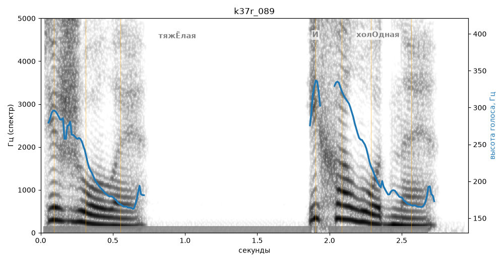

# k37r_089

Голос: **Рон, сборка 37f** · длительность 3.0 с
Эталон: Тяжёлая. И холодная!
Распознано: тяжелые и холодные.
Расхождения в словах: «тяжелая» → «тяжелые»; «холодная» → «холодные»

## Ударения
(где нужно: ruaccent)

| слово | нужно | у голоса | |
|---|---|---|---|
| тяжёлая | тяжЁлая | — | ? |
| холодная | холОдная | — | ? |

## Интонация
- ✗ «тяжёлая.» — конец фразы не понижается — звучит незаконченно / как перечисление
- ✓ «и холодная!» — выделено слово «и» (+3.6 пт)
- Диапазон голоса 11.8 полутонов (живо), средняя высота 199 Гц

## Паузы и темп
- после «тяжёлая.» пауза всего 0.02 с — фразы слипаются
- Темп 2.6 слога/с (медленно)

_Синяя линия — высота голоса. Над словами заглавная буква — где ударение должно быть; красным — голос поставил не туда (уверенно), оранжевым — возможно._
