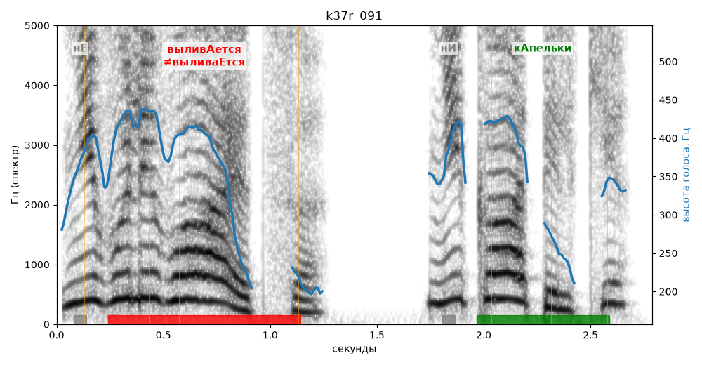

# k37r_091

Голос: **Рон, сборка 37f** · длительность 2.8 с
Эталон: Не выливается! Ни капельки!
Распознано: Не выливается! Не капельки!
Расхождения в словах: «ни» → «не»

## Ударения
(где нужно: ruaccent)

| слово | нужно | у голоса | |
|---|---|---|---|
| выливается | выливАется | выливаЕтся | ✗ ОШИБКА |
| капельки | кАпельки | кАпельки | ✓ |

## Интонация
- ✗ «не выливается!» — восклицание звучит ровно, без эмоции
- ✓ «ни капельки!» — выделено слово «капельки» (+3.2 пт)
- Диапазон голоса 13.0 полутонов (живо), средняя высота 372 Гц

## Паузы и темп
- паузы на своих местах
- Темп 5.4 слога/с (нормально)

_Синяя линия — высота голоса. Над словами заглавная буква — где ударение должно быть; красным — голос поставил не туда (уверенно), оранжевым — возможно._
