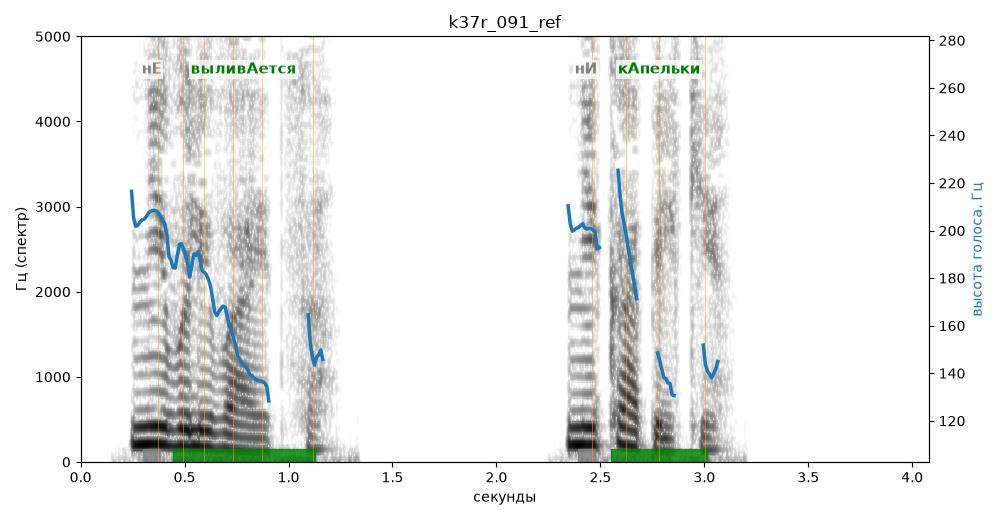

# k37r_091_ref

Голос: **edge:ru-RU-SvetlanaNeural** · длительность 4.1 с
Эталон: Не выливается! Ни капельки!
Распознано: Не выливается. Не капельки.
Расхождения в словах: «ни» → «не»

## Ударения
(где нужно: ruaccent)

| слово | нужно | у голоса | |
|---|---|---|---|
| выливается | выливАется | выливАется | ✓ |
| капельки | кАпельки | кАпельки | ✓ |

## Интонация
- ✓ «не выливается!» — выделено слово «не» (+3.5 пт)
- ✓ «ни капельки!» — выделено слово «ни» (+3.3 пт)
- Диапазон голоса 7.4 полутонов (живо), средняя высота 182 Гц

## Паузы и темп
- паузы на своих местах
- Темп 6.9 слога/с (быстро)

_Синяя линия — высота голоса. Над словами заглавная буква — где ударение должно быть; красным — голос поставил не туда (уверенно), оранжевым — возможно._
