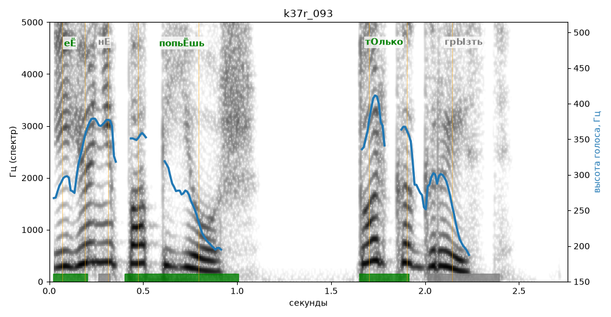

# k37r_093

Голос: **Рон, сборка 37f** · длительность 2.8 с
Эталон: Её не попьёшь! Только грызть!
Распознано: Её не попьёшь. Только грысть.
Расхождения в словах: «грызть» → «грысть»

## Ударения
(где нужно: ruaccent)

| слово | нужно | у голоса | |
|---|---|---|---|
| её | еЁ | еЁ | ✓ |
| попьёшь | попьЁшь | попьЁшь | ✓ |
| только | тОлько | тОлько | ✓ |

## Интонация
- ✗ «её не попьёшь!» — восклицание звучит ровно, без эмоции
- ✓ «только грызть!» — выделено слово «только» (+4.6 пт)
- Диапазон голоса 11.3 полутонов (живо), средняя высота 297 Гц

## Паузы и темп
- паузы на своих местах
- Темп 4.6 слога/с (нормально)

_Синяя линия — высота голоса. Над словами заглавная буква — где ударение должно быть; красным — голос поставил не туда (уверенно), оранжевым — возможно._
