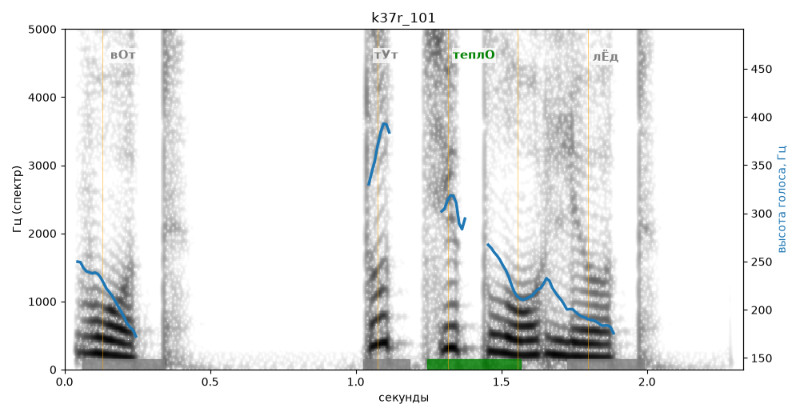

# k37r_101

Голос: **Рон, сборка 37f** · длительность 2.3 с
Эталон: Вот. Тут тепло, лёд.
Распознано: Вот. Тут тепло лёт.
Расхождения в словах: «лед» → «лет»

## Ударения
(где нужно: ruaccent)

| слово | нужно | у голоса | |
|---|---|---|---|
| тепло | теплО | теплО | ✓ |

## Интонация
- ✓ «тут тепло лёд.» — конец фразы понижается — звучит законченно
- Диапазон голоса 12.2 полутонов (живо), средняя высота 222 Гц

## Паузы и темп
- паузы на своих местах
- Темп 4.6 слога/с (нормально)

_Синяя линия — высота голоса. Над словами заглавная буква — где ударение должно быть; красным — голос поставил не туда (уверенно), оранжевым — возможно._
