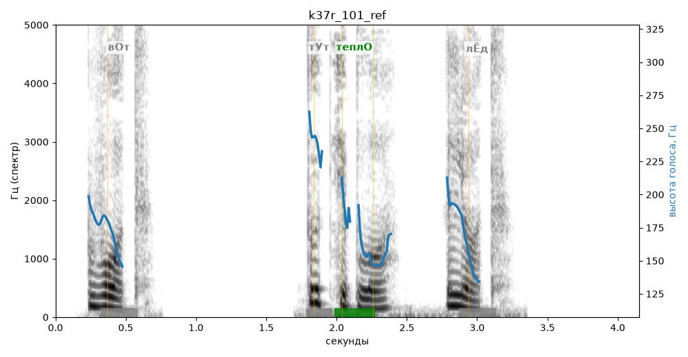

# k37r_101_ref

Голос: **edge:ru-RU-SvetlanaNeural** · длительность 4.2 с
Эталон: Вот. Тут тепло, лёд.
Распознано: Вот. Тут тепло. Лет.
Расхождения в словах: «лед» → «лет»

## Ударения
(где нужно: ruaccent)

| слово | нужно | у голоса | |
|---|---|---|---|
| тепло | теплО | теплО | ✓ |

## Интонация
- ✓ «тут тепло лёд.» — конец фразы понижается — звучит законченно
- Диапазон голоса 9.4 полутонов (живо), средняя высота 176 Гц

## Паузы и темп
- паузы на своих местах
- Темп 5.0 слога/с (нормально)

_Синяя линия — высота голоса. Над словами заглавная буква — где ударение должно быть; красным — голос поставил не туда (уверенно), оранжевым — возможно._
