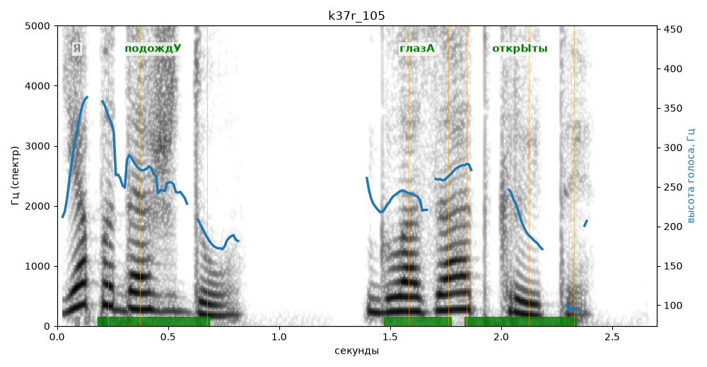

# k37r_105

Голос: **Рон, сборка 37f** · длительность 2.7 с
Эталон: Я подожду. Глаза открыты.
Распознано: Я подожду. Глаза открыты.
Слова: все совпали

## Ударения
(где нужно: ruaccent)

| слово | нужно | у голоса | |
|---|---|---|---|
| подожду | подождУ | подождУ | ✓ |
| глаза | глазА | глазА | ✓ |
| открыты | открЫты | открЫты | ✓ |

## Интонация
- ✓ «я подожду.» — конец фразы понижается — звучит законченно
- ✓ «глаза открыты.» — конец фразы понижается — звучит законченно
- Диапазон голоса 12.2 полутонов (живо), средняя высота 242 Гц

## Паузы и темп
- паузы на своих местах
- Темп 5.4 слога/с (нормально)

_Синяя линия — высота голоса. Над словами заглавная буква — где ударение должно быть; красным — голос поставил не туда (уверенно), оранжевым — возможно._
