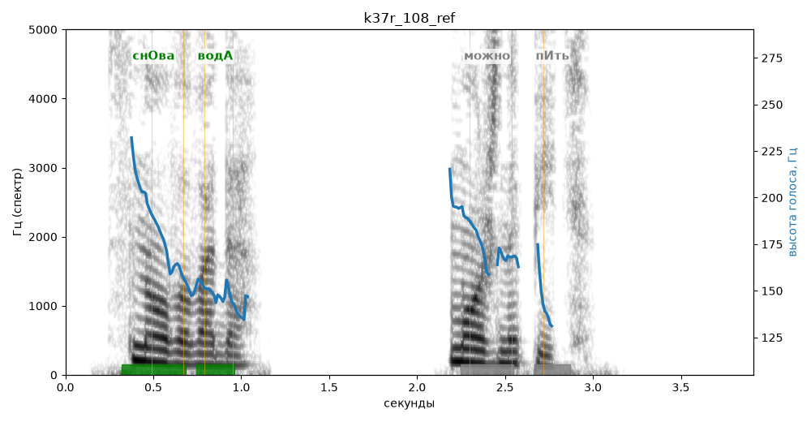

# k37r_108_ref

Голос: **edge:ru-RU-SvetlanaNeural** · длительность 3.9 с
Эталон: Снова вода! Можно пить!
Распознано: Снова вода. Можно пить.
Слова: все совпали

## Ударения
(где нужно: ruaccent)

| слово | нужно | у голоса | |
|---|---|---|---|
| снова | снОва | снОва | ✓ |
| вода | водА | водА | ✓ |
| можно | можно | мОжно | нет эталона |

## Интонация
- ✓ «снова вода!» — выделено слово «снова» (+3.5 пт)
- ✗ «можно пить!» — восклицание звучит ровно, без эмоции
- Диапазон голоса 7.1 полутонов (живо), средняя высота 164 Гц

## Паузы и темп
- паузы на своих местах
- Темп 5.5 слога/с (нормально)

_Синяя линия — высота голоса. Над словами заглавная буква — где ударение должно быть; красным — голос поставил не туда (уверенно), оранжевым — возможно._
