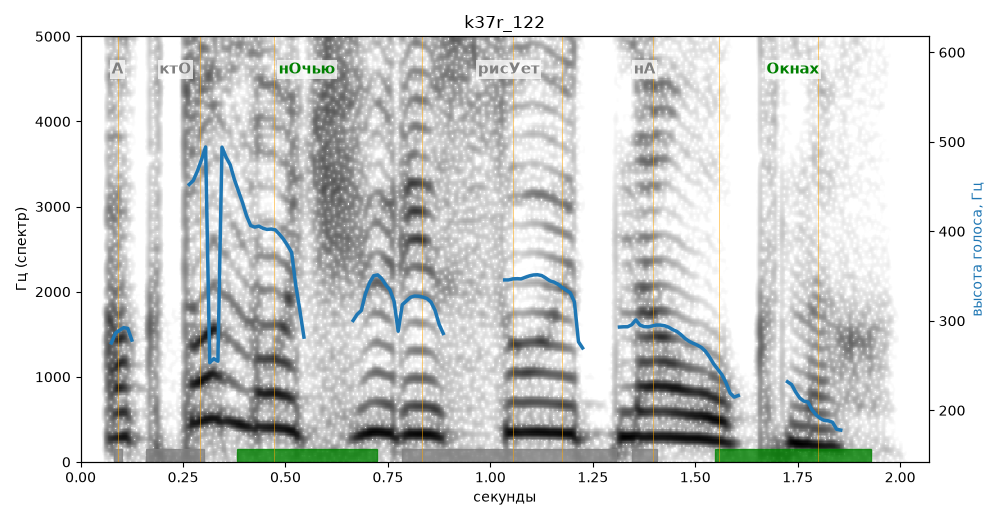

# k37r_122

Голос: **Рон, сборка 37f** · длительность 2.1 с
Эталон: А кто ночью рисует на окнах?
Распознано: А кто на очереди рисует на окнах?
Расхождения в словах: «ночью» → «на очереди»

## Ударения
(где нужно: ruaccent)

| слово | нужно | у голоса | |
|---|---|---|---|
| ночью | нОчью | нОчью | ✓ |
| рисует | рисУет | рИсует | ? не разобрать |
| окнах | Окнах | Окнах | ✓ |

## Интонация
- ✓ «а кто ночью рисует на окнах?» — вопросительный подъём на слове «кто»
- Диапазон голоса 14.8 полутонов (живо), средняя высота 309 Гц

## Паузы и темп
- паузы на своих местах
- Темп 4.9 слога/с (нормально)

_Синяя линия — высота голоса. Над словами заглавная буква — где ударение должно быть; красным — голос поставил не туда (уверенно), оранжевым — возможно._
