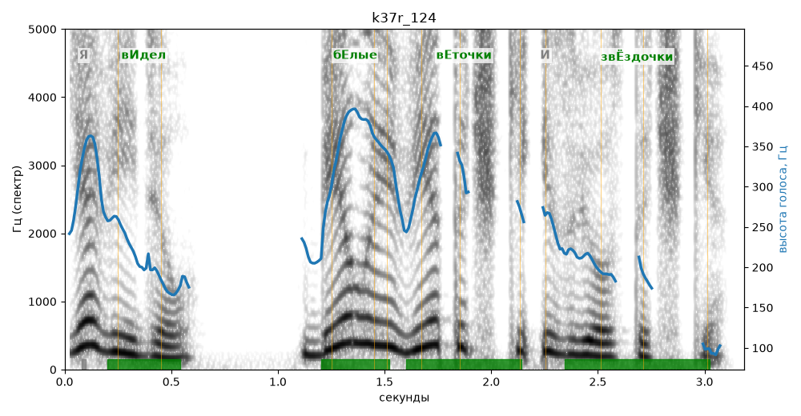

# k37r_124

Голос: **Рон, сборка 37f** · длительность 3.2 с
Эталон: Я видел. Белые веточки и звёздочки.
Распознано: Я видел белые веточки из вёздочки.
Расхождения в словах: «и звездочки» → «из вездочки»

## Ударения
(где нужно: ruaccent)

| слово | нужно | у голоса | |
|---|---|---|---|
| видел | вИдел | вИдел | ✓ |
| белые | бЕлые | бЕлые | ✓ |
| веточки | вЕточки | вЕточки | ✓ |
| звёздочки | звЁздочки | звЁздочки | ✓ |

## Интонация
- ✓ «белые веточки и звёздочки.» — конец фразы понижается — звучит законченно
- Диапазон голоса 14.5 полутонов (живо), средняя высота 249 Гц

## Паузы и темп
- паузы на своих местах
- Темп 5.3 слога/с (нормально)

_Синяя линия — высота голоса. Над словами заглавная буква — где ударение должно быть; красным — голос поставил не туда (уверенно), оранжевым — возможно._
