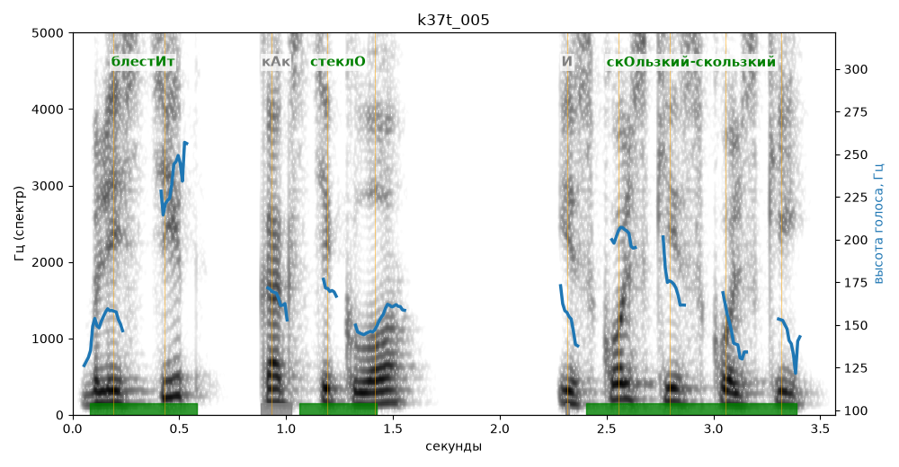

# k37t_005

Голос: **Топа, сборка 37f** · длительность 3.6 с
Эталон: Блестит, как стекло. И скользкий-скользкий.
Распознано: блестит как стекло. Искользки и скользки.
Расхождения в словах: «» → «искользки»; «скользкий-скользкий» → «скользки»

## Ударения
(где нужно: ruaccent)

| слово | нужно | у голоса | |
|---|---|---|---|
| блестит | блестИт | блестИт | ✓ |
| стекло | стеклО | стеклО | ✓ |
| скользкий-скользкий | скОльзкий-скользкий | скОльзкий-скользкий | ✓ |

## Интонация
- ✓ «блестит как стекло.» — конец фразы понижается — звучит законченно
- ✗ «и скользкий-скользкий.» — конец фразы не понижается — звучит незаконченно / как перечисление
- Диапазон голоса 9.7 полутонов (живо), средняя высота 160 Гц

## Паузы и темп
- паузы на своих местах
- Темп 4.7 слога/с (нормально)

_Синяя линия — высота голоса. Над словами заглавная буква — где ударение должно быть; красным — голос поставил не туда (уверенно), оранжевым — возможно._
